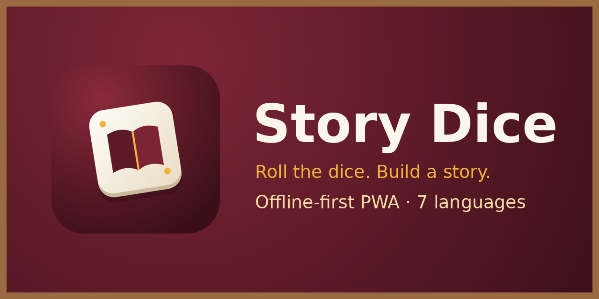

<p align="center">
  
</p>

# Story Dice

[](https://github.com/kozliatko/storydice/releases)
[](LICENSE)


An offline-first storytelling dice game. Roll the dice, look at the pictures, and build one story out of them. Works as an installable PWA on phones, tablets and desktops.

> The app was originally written in Slovak ("Kocky príbehov"); the source and the default UI strings in `site/index.html` are in Slovak, and the UI is available in 7 languages.

## Features

- **4 picture sets**: classic, universal, travel and household (54 pictures each, 9 dice with 6 faces).
- **3, 6 or 9 dice** per roll, with the option to re-roll a single die.
- **Game modes**
  - *Classic*: roll and tell a story.
  - *Relay*: 2–9 players, each continues the story with the next picture.
  - *Theme*: a random theme to build the story around.
  - *Surprise*: dice start face-down and are revealed one at a time.
- **Optional timer** (60, 120 or 180 seconds) with an audible alert.
- **Fullscreen play**: an optional mode where the first roll switches the dice tray to fullscreen (with a native Fullscreen API and a CSS fallback for iPhone). Relay and theme controls stay available in fullscreen.
- An option to show picture names.
- **Languages**: Slovak, English, German, Hungarian, Czech, Spanish and French. The language is detected from the browser and can be changed manually.
- **Light and dark theme**, keyboard accessible, respects `prefers-reduced-motion`.
- **Offline**: a service worker caches the whole app after the first visit.
- **No dependencies, no tracking, no external requests.** Fonts are embedded.

## Tech stack

| Technology | Used for |
|---|---|
|    | The whole app: plain HTML, CSS and vanilla JavaScript in a single file, no framework and no build step |
|  | Web app manifest and a service worker for installability and offline use |
|  | `update-sw.py`, a standard-library script that regenerates the service worker cache version |
|   | Container image serving the static files |
|  | Reverse proxy and automatic HTTPS via caddy-docker-proxy |

## Project layout

| Path | Purpose |
|---|---|
| `site/` | The application: `index.html` (HTML, CSS, JS, translations, fonts), `manifest.webmanifest`, `sw.js`, `icons/` |
| `nginx.conf` | Static server configuration used by the Docker image |
| `Dockerfile` | nginx:alpine image serving `site/` |
| `docker-compose.yml` | Example deployment behind [caddy-docker-proxy](https://github.com/lucaslorentz/caddy-docker-proxy) |
| `licenses/` | Licences of bundled third-party fonts |

## Running locally

No build step is needed. Serve the `site/` directory with any static server:

```sh
cd site
python3 -m http.server 8000
# open http://localhost:8000
```

Service workers work only on `localhost` or over HTTPS. To test offline mode, open DevTools, enable *Offline* and reload the page.

## Docker

```sh
docker build -t story-dice .
docker run --rm -p 8080:80 story-dice
# open http://localhost:8080
```

## Deployment

The provided `docker-compose.yml` expects an external Docker network named `caddy` and a running caddy-docker-proxy instance. Copy `.env.example` to `.env`, set `DOMAIN` to your own domain and start the stack:

```sh
cp .env.example .env          # then edit DOMAIN
docker network create caddy   # once, if it does not exist yet
docker compose up -d --build
```

Any other static hosting works too: upload the contents of `site/` (relative paths are used, so a sub-directory is fine) and serve it over HTTPS. Do not send long `Cache-Control` headers for `sw.js`, otherwise updates will not reach users. See `nginx.conf` for a reference.

## Updating the app

The service worker cache name contains a version hash of the app files (`VERSION` in `site/sw.js`). Whenever a file in `site/` changes, `VERSION` must change as well, otherwise returning visitors keep the old cached version. Regenerate it with the bundled script (Python 3.8+, standard library only):

```sh
cd site
python3 update-sw.py          # update VERSION and the ASSETS list in sw.js
python3 update-sw.py --check  # only report whether sw.js is up to date (exit code 1 if not)
```

A new service worker activates immediately and the new version is shown on the next launch.

## Contributing

Issues and pull requests are welcome. See [CONTRIBUTING.md](CONTRIBUTING.md). Notable changes are listed in [CHANGELOG.md](CHANGELOG.md). To report a vulnerability, see [SECURITY.md](SECURITY.md).

## Licence

The source code is released under the [MIT License](LICENSE). Bundled fonts (Baloo 2 and Nunito) are licensed under the SIL Open Font License 1.1, see [THIRD_PARTY_NOTICES.md](THIRD_PARTY_NOTICES.md).

## Disclaimer

This is an independent project. It is not affiliated with, endorsed by or sponsored by the makers of any commercial storytelling dice product.
